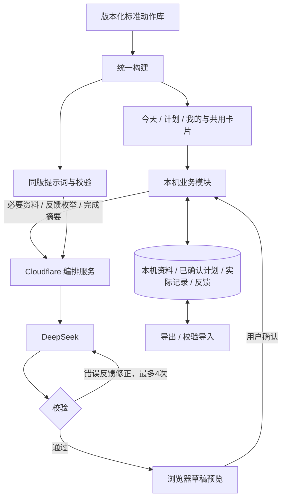

# 轻练应用架构

固定动作定义、计划处方、实际记录分开；所有个人数据保存在当前浏览器。

- `library/exercise-library.json`：发布版本唯一源文件。
- `src/catalog.mjs` 与 `src/prescriptions.mjs`：标准定义、适用场景、计量与固定内容解析。
- `src/standard-plan.mjs`：28天阶段框架、本机规则和7天周期。
- `src/ai-plan.mjs`：最少资料、共享提示词、草稿校验。
- `cloud/deepseek.mjs`：有限重试、错误修正、时限与取消。
- `src/cycle-plan.mjs`：周反馈、完成摘要、目标周期确认与历史保护。
- `src/domain.mjs` 与 `src/local-store.mjs`：记录、计时、事务版本、本机备份与兼容读取。
- `web/components.mjs`：动作卡、周期卡、草稿预览等固定交互组件。

一个阶段包含4个周期，每个周期7天。每日安排包含标准动作处方和餐饮建议。动作处方通过 id 与 libraryVersion 引用固定定义，并保存 taskId。实际记录仍以日期和动作编号存储以兼容旧备份，并携带 taskId；同一天不允许重复动作编号。

计划确认时保存 profileSnapshot 和 librarySnapshots。不同版本的动作定义独立保留。首次只展开第一周，未来周期不伪造详细训练量。完成摘要只读取已完成记录，未知实际时长与距离不使用计划值补齐。

生成及预览暂存于请求和页面内存；刷新或关闭会丢弃草稿。正式数据只在用户确认后写入。版本冲突、既有训练记录、活动计时、疼痛反馈或不合格回答均阻止覆盖。新版不会删除旧计划；旧阶段未来周期首次更新前另存升级备份。

GitHub Pages仅提供静态内容；Cloudflare Secret保存模型密钥。个人记录不上传GitHub，不写入Cloudflare数据库。站点邀请码保留，每日生成次数和请求间隔限制保持关闭。已有旧 Durable Object 类仅用于部署迁移兼容，不参与生成。
